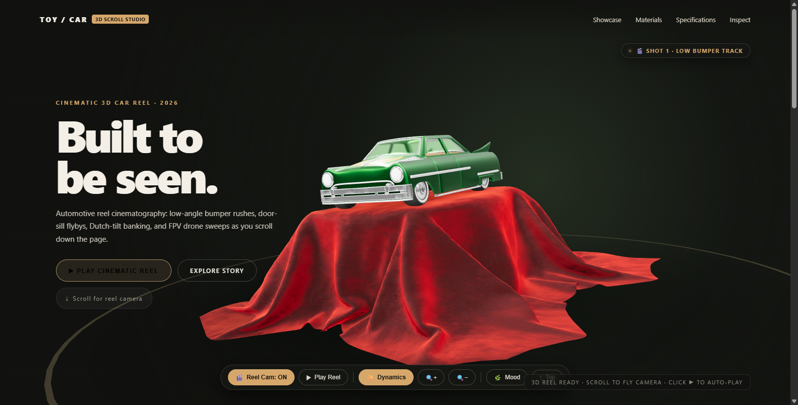
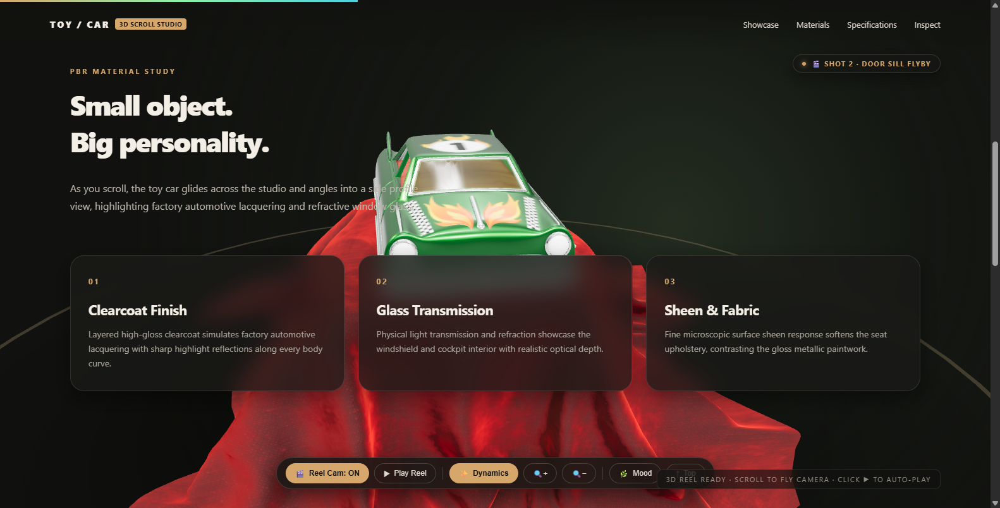
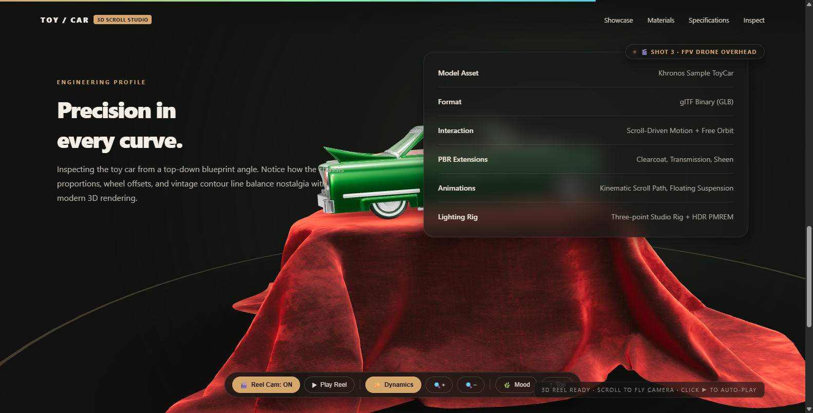
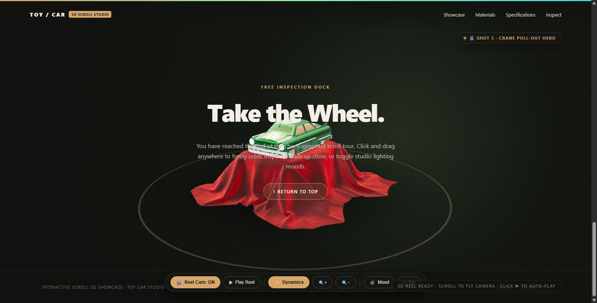

# 🏎️ 3D Toy Car Website

<div align="center">

[](https://threejs.org/)
[](https://www.khronos.org/webgl/)
[](LICENSE)

An interactive 3D car website featuring scroll-driven automotive camera reels, realistic physics, and PBR material lighting built with Three.js.

<br/>



</div>

---

## 📸 Previews

| Hero Showcase | Materials Study |
| :---: | :---: |
|  |  |
| **Low Bumper Track** | **Door Sill Flyby** |

| Engineering Specs | 360° Inspection Dock |
| :---: | :---: |
|  |  |
| **Overhead FPV View** | **Free Orbit & Lighting Modes** |

---

## ✨ Features

- 🎬 **Cinematic Camera Reel**: 5 dynamic camera angles that fly around the car as you scroll.
- ▶ **Auto-Play Mode**: Sit back and watch a 14-second automated cinematic reel.
- 🏎️ **Chassis Physics**: Acceleration squats, braking dives, and body lean tied to scroll speed.
- 🔍 **Zoom & Free Orbit**: Click and drag to inspect details or use the zoom buttons.
- 🌿 **Lighting Moods**: Switch between Emerald, Ruby, and Cyber Neon studio lighting.
- 📂 **Custom Model Support**: Drag and drop any `.glb` or `.gltf` file directly onto the page.
- ⚡ **Zero Setup**: Runs directly in the browser with no build step required.

---

## 🎮 Controls

| Action | Control |
| :--- | :--- |
| **Scroll Reel** | Mouse wheel or trackpad up / down |
| **Free Orbit** | Left-click and drag anywhere |
| **Auto-Play Reel** | Click **`▶ Play Reel`** |
| **Zoom In / Out** | Click **`🔍+`** / **`🔍−`** or hold **`Ctrl + Wheel`** |
| **Toggle Reel Mode** | Click **`🎬 Reel Cam`** |
| **Switch Lighting** | Click **`🌿 Mood`** |

---

## 🚀 How to Run

1. **Option A (Instant)**: Double-click `index.html` to open it in your browser.
2. **Option B (Recommended)**: Double-click `start_showcase.bat` or run:
   ```bash
   python -m http.server 8000
   ```
   Then open `http://localhost:8000`.

---

## 📄 License

MIT License © 2026 [Sooraj Studio](https://github.com/soorajstudio)
